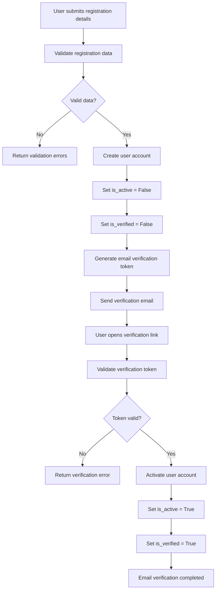
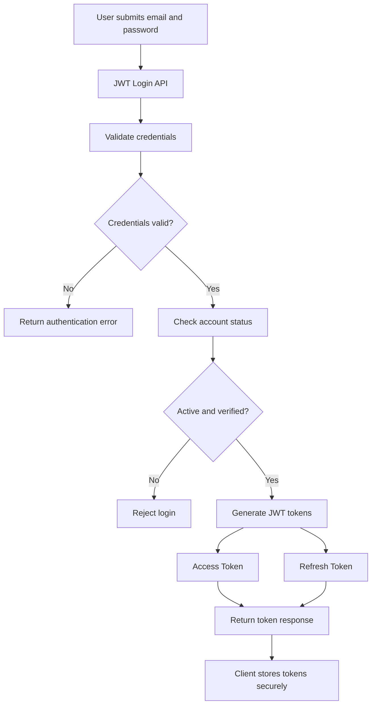
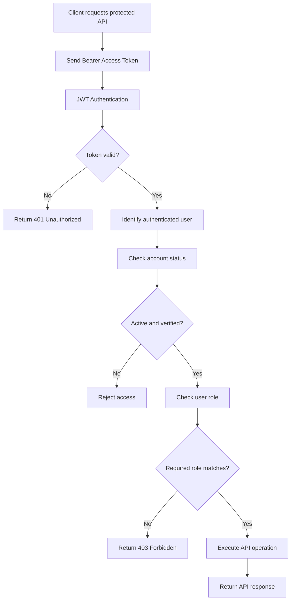
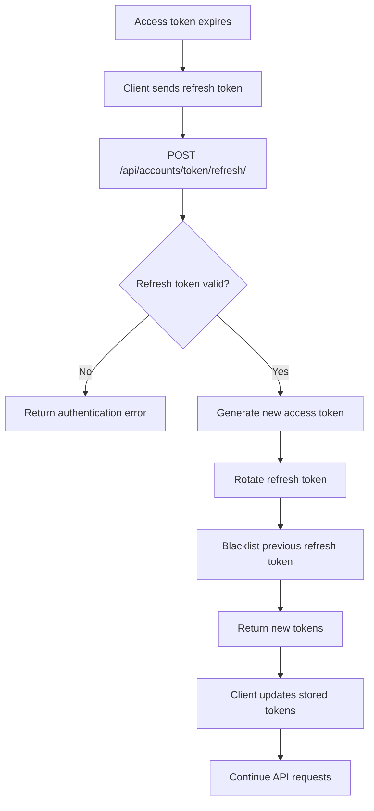
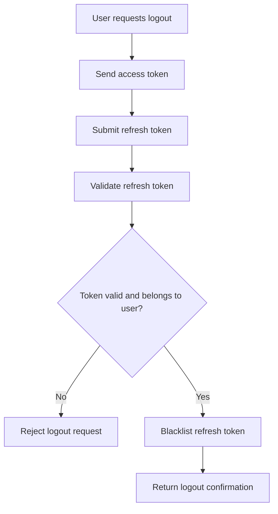

# Zecpath ATS – Authentication Flow Diagrams

## 1. Overview

Zecpath uses Django REST Framework (DRF) with JSON Web Token (JWT) authentication.

The authentication system supports three user roles:

- **ADMIN** – System administrator
- **EMPLOYER** – Employer account
- **CANDIDATE** – Candidate account

Newly registered users must verify their email address before accessing protected APIs.

## 2. User Registration and Email Verification

This flow describes how a new candidate or employer creates an account and verifies their email address.

**Important points:**

- Newly registered accounts are inactive and unverified.
- Verification tokens are time-sensitive.
- Invalid, expired or previously used tokens are rejected.
- The token is invalidated when relevant account information changes.

## 3. User Login and JWT Generation

After successful email verification, the user can log in.

**Login endpoint:**

`POST /api/accounts/login/`

**JWT configuration:**

| Setting | Value |
|---|---|
| Access token lifetime | 30 minutes |
| Refresh token lifetime | 1 day |
| Authentication header | Bearer |
| Token rotation | Enabled |
| Blacklist after rotation | Enabled |

## 4. Authenticated API Request and Role-Based Access Control

The client sends its access token when accessing protected APIs.

**Role-based permissions:**

| Permission class | Required role |
|---|---|
| `IsAdmin` | ADMIN |
| `IsEmployer` | EMPLOYER |
| `IsCandidate` | CANDIDATE |

Protected APIs also enforce resource ownership where applicable.

## 5. JWT Refresh Token Flow

When the access token expires, the client can request a new access token using its refresh token.

**Important:** Refresh token rotation is enabled. The client must use the newly returned refresh token for subsequent refresh requests.

## 6. User Logout Flow

Zecpath uses refresh token blacklisting to prevent reuse of a logged-out session's refresh token.

**Important security considerations:**

- A user cannot blacklist another user's refresh token.
- A blacklisted refresh token cannot be reused.
- Existing access tokens remain valid until their expiration unless additional access-token revocation is implemented.

## 7. Authentication API Endpoints

| Operation | Method | Endpoint |
|---|---|---|
| Login | POST | `/api/accounts/login/` |
| Refresh token | POST | `/api/accounts/token/refresh/` |
| Logout | POST | `/api/accounts/logout/` |

Registration and email verification endpoints are documented in the API usage guide.

## 8. Security Summary

- JWT authentication is used for protected APIs.
- Email verification is required before account access.
- Access tokens expire after 30 minutes.
- Refresh tokens expire after one day.
- Refresh token rotation and blacklisting are enabled.
- Logout validates refresh-token ownership.
- Role-based permissions protect role-specific APIs.
- Resource ownership is enforced by the relevant API views.

---

**Project:** Zecpath ATS  
**Documentation:** Authentication Flow Diagrams  
**Technology:** Django, Django REST Framework, Simple JWT  
